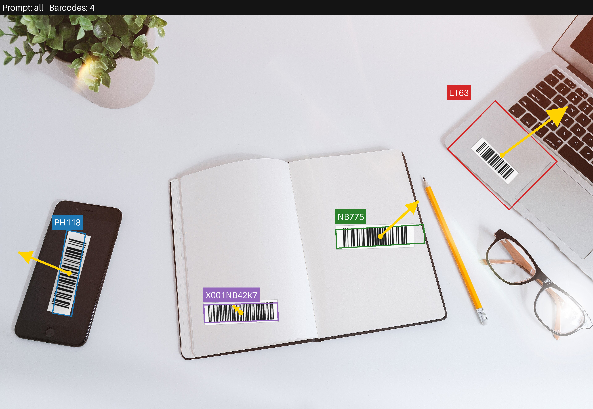

# shelfvision

**Find objects by name in a photo, read the Code128 labels stuck on them, and tell which way each label
faces in 3D.**

shelfvision is a small vision tool for warehouse and robotic picking: a camera looks at a desk or a
shelf, someone asks for "the mug", and the tool answers with the mug's box, the value of its label and
the 3D direction the label faces, so that a robot arm could approach it straight on. It also works the
other way round: given a label value, it says which object carries it.

It needs no training data. Objects are found zero-shot with OWLv2, the barcodes are read by a Code128
decoder written from scratch, without any barcode library, and the surface normals come from MoGe-2, a
monocular geometry model. It runs on a CPU, or on an NVIDIA GPU when there is one.



## What it does

| Function | Input | Output |
|---|---|---|
| Find objects | a list of names, or `"all"` | the image with the box and name of each object found |
| Read barcodes | a list of names, or `"all"` | for each Code128 label on those objects: its outline, decoded value and a 3D arrow along its surface normal |
| Link labels and objects | an object name or a barcode value | the values on that object, or the object that carries that value |
| Export | any query | a JSON report: objects, barcodes with corners and unit normal, owner of each code, seconds per stage |

```python
from pathlib import Path
from shelfvision.orchestrator import Orchestrator

scene = Orchestrator(device="auto").open(Path("examples/input/input_5.jpg"))
scene.draw_detections(["laptop", "mug"])   # boxes of the requested objects
scene.draw_barcodes("all")                  # every label: outline, value and normal arrow
scene.relate("mug")                         # values printed on the mug
scene.relate("MG466")                       # the object that carries MG466
scene.report("all")                         # everything as plain data, ready for JSON
```

## Quick start

The project uses [pixi](https://pixi.sh), which installs Python 3.12 and every library with the exact
versions pinned in `pixi.lock`, in a folder of its own: one command gives the same environment on any
Windows or Linux machine.

```bash
pixi install                 # CPU environment
pixi run notebook            # open demo.ipynb, the end-to-end demo with saved outputs
pixi run test                # 439 fast tests; `pixi run test-slow` adds 10 that load the real models
pixi run lint                # ruff
pixi run -e gpu notebook     # the same with the CUDA build of PyTorch, for an NVIDIA GPU
```

The model weights are downloaded from Hugging Face on the first run: OWLv2 about 590 MB, MoGe-2 about
135 MB, and SAM 2.1 tiny about 150 MB, only if segmentation is turned on. macOS is not supported: MoGe's
dependencies need `triton`, which has no macOS build; the notebook keeps its outputs, so it can still be
read there.

## How it works

```text
                              photo (RGB, any size)
                                       |
          +----------------------------+-----------------------------+
          |                            |                             |
          v                            v                             v
   OWLv2, zero-shot             Code128 reader                MoGe-2, monocular
   boxes and names            (own code, no library)        normal map and focal
          |                   value and outline of                   |
          |                      each barcode                        |
          |                            |                             |
          |                            +-----------+-----------------+
          |                            |           |
          v                            v           v
     objects found  ----->   LINK: a barcode belongs   normal of each barcode =
                             to the smallest box that  median of the map inside it
                             holds its centre                |
                                       |                     v
                                       v               3D arrow per label
                          name <-> value answers
```

- **Objects.** OWLv2 (`google/owlv2-base-patch16-ensemble`) sees the photo at 960 px. With a list, each
  name is scored on every box and must also beat the closest words of a general vocabulary of 53 words,
  so that an absent object gives no box. With `"all"`, the boxes that look like separate objects are
  kept (objectness, non-maximum suppression, no box larger than 35 % of the photo) and named with that
  vocabulary; a name scored below 0.25 is shown as `object`.
- **Barcodes, written from scratch.** The reader finds areas of strong gradients that share one
  direction, turns each one along the label's axis, corrects the slant of the bars, and reads rows of
  pixels: bar and space widths, compared in pairs so that blur and ink spread cancel out, then the
  Code128 checksum and the white margin after the stop. A value is accepted only when several row
  blocks vote for it, which is why it gives no false values. I wrote it instead of using a library such
  as ZXing or pyzbar to control every failure mode and to understand where 1D decoding breaks.
- **Normals.** MoGe-2 (`Ruicheng/moge-2-vits-normal`) gives a normal for every pixel and the camera's
  focal length, which photos do not carry. The normal of a label is the median inside its outline,
  turned towards the camera; the arrow is 1.5 label widths long in 3D, which needs no depth to draw.
- **Linking.** A barcode belongs to the smallest object box that holds its centre; its value is never
  compared with the object's name. An exact barcode value is matched first, then a name, and an empty
  answer always comes with its reason.
- **Optional segmentation.** With `Orchestrator(segment=True)`, SAM 2.1 (`facebook/sam2.1-hiera-tiny`)
  outlines each detected object and linking uses the outlines. Off by default.
- **Caching.** Each stage runs only when a query needs it, once per photo, so repeated or related queries
  are answered from memory.

## Example photos and ground truth

The seven photos in `examples/input` are public-domain (CC0) desk photos from Wikimedia Commons; their
authors and links are in [`examples/input/SOURCES.md`](examples/input/SOURCES.md). They carry no
barcodes, so [`tools/make_examples.py`](tools/make_examples.py) stuck 23 Code128 labels on flat parts
of the objects: each label is drawn sharp, warped onto four corners picked by hand, lit like the
surface under it, slightly blurred and given sensor noise. The script writes the value, corners and
owner of every label to `examples/input/labels.json`, the ground truth of the benchmarks, together with
the object boxes drawn by hand in `benchmarks/ground_truth.py` (49 objects).

The labels are synthetic; the scenes are not. Busy desks with keyboards, handwriting and wood grain, and
objects the detector's thresholds had never seen: the reader and the detector were first tuned on
eight photos of one simple table scene, which are not part of this repository, and these photos are
the test of how well that carries over.

## Results

Measured with the scripts in `benchmarks/` on the seven photos on 2026-11-18, on a laptop CPU (AMD Ryzen 5
7520U, 8 logical cores, 15 GiB of RAM, no GPU, Windows 11).

| Part | Result |
|---|---|
| Barcode values | **21/23 labels read, 0 false values**; missed: a label on a mouse pad seen at a grazing angle, and one on a black laptop screen |
| Barcode outlines | 12/21 match their label (IoU >= 0.5); the others spread over the background, see the limitations |
| Random labels pasted on photo crops (seed 2027) | **65/90 read, 0 false values**; 29/44 with modules of 2.7 px or more |
| Robustness: 19 altered photos and edge cases | **0 exceptions, 0 false values**; codes survive rotation, darkening, JPEG quality 10 and reduction to 1920 px; they are lost at 640 px and with blur |
| Normals: two flat labels in one photo, which must be parallel (13 pairs) | median error **3.9°**, max 21.4° |
| Normals: a flat and an upright label, which must be at 90° (7 pairs) | median error 29.7°, max 61.2°; the loose outlines on the mugs pull in the table |
| Objects, `"all"` | 33/49 objects boxed, 23 named right, 5 named `object`, 16 extra boxes |
| Objects, a list of 21 present and 10 absent names | default threshold 0.34: 34 found, 24 wrong boxes, 15 missed; **no box for any of the 10 absent names** on the 7 photos |
| Linking, with hand-drawn boxes | **20/21** codes on the right object, even among eight mugs |
| Linking, with the detector's boxes | 11/21 codes on the right box: the detector's misses carry over |
| Consistency | identical outputs in two runs with fresh state, 7/7 photos |
| Tests | 449 passing: 439 fast, 10 with the real models |

Seconds per photo in the notebook run of 2026-11-18, with the laptop doing nothing else, 8 torch threads:

| Stage | Seconds |
|---|---:|
| OWLv2, image features | 13.4 |
| Barcode reading | 104.0 (20 to 149) |
| MoGe-2, normal map | 6.0 |
| All the stages of a new photo | 124.0 |
| The same queries again on a photo | 0.10 |
| SAM 2.1, optional: image and outlines | 10.2 + 3.7, measured with other benchmarks running |

The notebook saved here is a later run: `docs/execution-time-report.md` compares its times with these.

## Validating thresholds on new scenes

The thresholds were first chosen on eight photos of a single table scene (not published here). Moving
to seven different desks showed which ones carry over, and changed three things:

- **The barcode reader's thresholds carry over.** 21 of 23 new labels read and no false value on new
  scenes, and the same 30/32 and 0 false values as before on the first scene.
- **The query threshold did not.** 0.22 was best on the first scene alone (F1 0.85) but let many false
  boxes through on the desks (F1 0.58). Measuring several values on both sets together, 0.34 gives the
  best F1 over all 15 photos, 0.71 (0.81 on the first scene and 0.64 on the desks), and it is the new
  default.
- **Reading got cheaper on wide strips, with the same result.** On a desk seen from above, wood grain
  looks like bars and the locator returns striped areas covering up to 65 % of the photo. Reading them
  was slow because a Gaussian blur over lines of 20 000 samples, with windows of 1 700, took 70 % of the
  time. Past a window of 511 samples the same blur now goes through the FFT: the same values to within
  0.001 gray levels, about 25 times faster on those lines. Skipping large areas altogether was tried and
  rejected, because it also skips real labels in close-ups: 44/90 random labels read with a limit of
  20 % of the image and 58/90 with 50 %, against 65/90 without.
- **When two areas read the same label, the tighter outline wins.** A striped area of background that
  also holds a label gives its value with an outline much larger than the label, and it used to win
  because the largest areas are read first. Keeping the smallest outline raised the outlines that match
  their label from 9 to 12 of 21, and the codes linked to the right hand-drawn object from 16 to 20.

## Limitations and next steps

- **Barcode outlines on busy backgrounds.** The value is read right, but on 9 of 21 labels the outline
  spreads over the textured background around the label. The normal and the owner of a code are taken
  inside that outline, so they suffer: it causes the large normal errors on the mugs. Refining the
  outline from the decoded bars (where the start and stop symbols are) is the next improvement.
- **Speed on cluttered scenes.** On a clean table the reader takes about 7 s per photo; on these desks
  20 to 149 s, 104 on average, because keyboards, handwriting and wood grain give 15 to 68 striped
  areas to check. A fast classifier to discard non-barcode areas before decoding would cut most of it.
  A GPU only speeds up the models, not the reader.
- **The detector on unseen scenes.** With `"all"`, small objects (pens, mice), plants seen from above and
  anything larger than 35 % of the photo (a monitor close up) are missed, and names outside the
  53-word vocabulary (tablet, glasses, mouse pad) come out as the nearest word or `object`. A larger
  vocabulary, or asking for the expected names, helps.
- **Small or blurred codes.** Reduced to 640 px or blurred, the photos lose all their codes.
- **Synthetic labels.** The labels were added by software on real photos; they are lit and blurred like
  the scene, but real printed labels would also bend with curved surfaces and catch reflections.

## Project layout

```text
src/shelfvision/      the library: detector, barcode locator and reader, normals, linking, drawing, export
demo.ipynb            end-to-end demo with saved outputs
tests/                449 pytest tests (10 marked slow load the real models)
benchmarks/           the scripts behind every number above, and the ground truth
tools/make_examples.py  builds the example photos and labels.json from the CC0 originals
examples/input/       the seven photos, labels.json and SOURCES.md
examples/output/      images and JSON reports written by the notebook
docs/                 execution time report, rewritten on every notebook run
```

## License

The code is under the [Apache License 2.0](LICENSE).

Photos: CC0, see [`examples/input/SOURCES.md`](examples/input/SOURCES.md). Model weights are downloaded
at run time under their own licenses: OWLv2 and SAM 2.1 (Apache 2.0), MoGe-2 (MIT).
